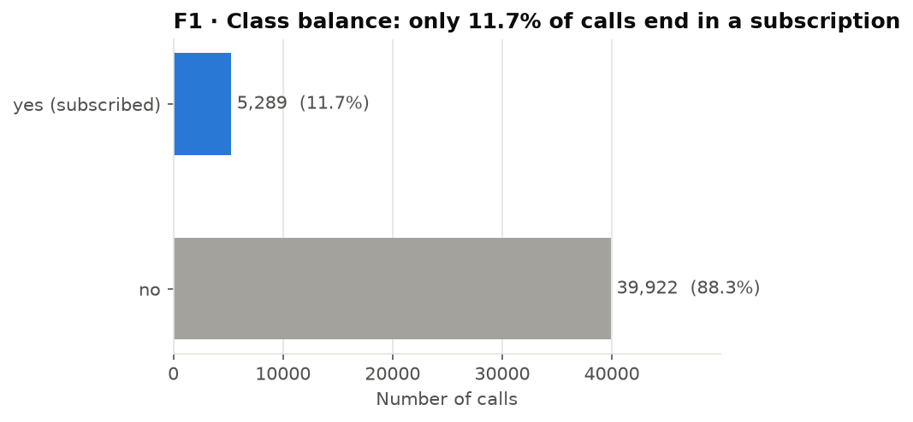
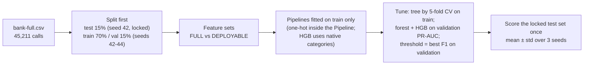
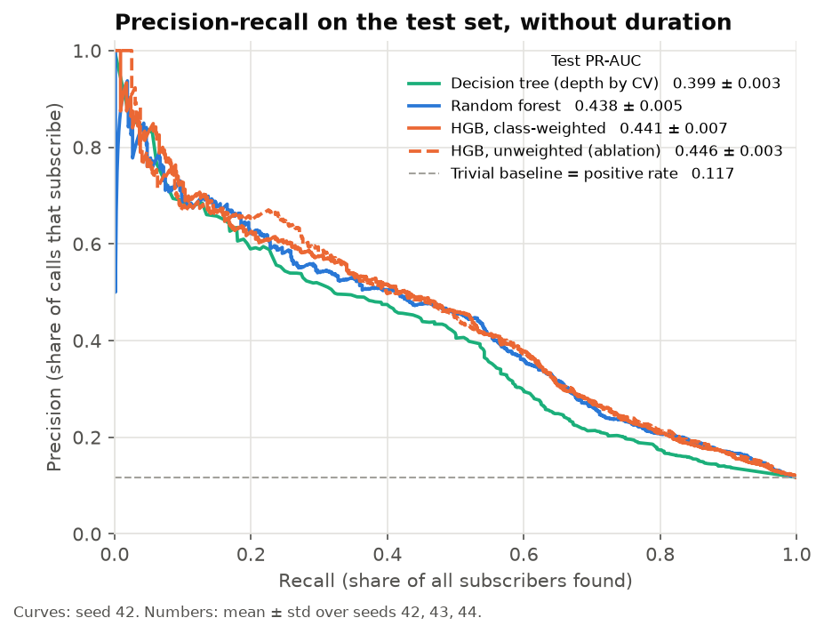
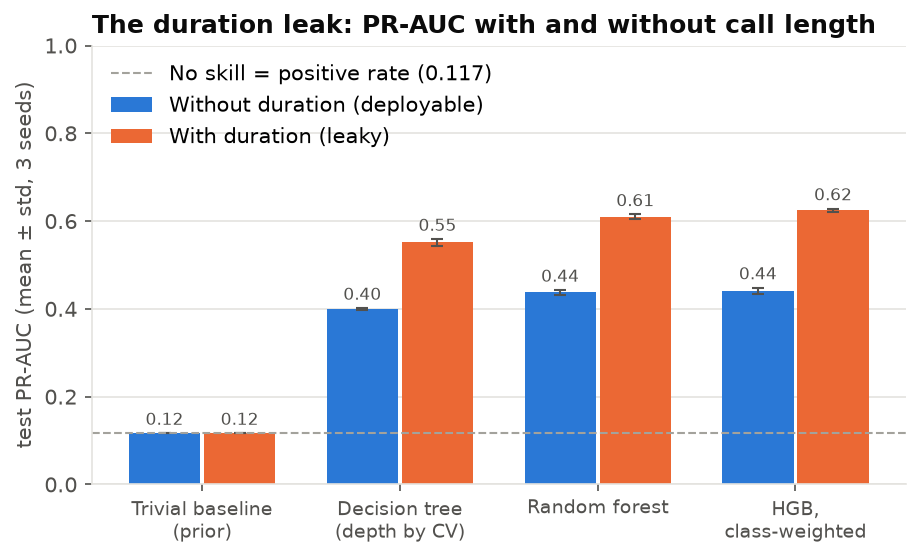
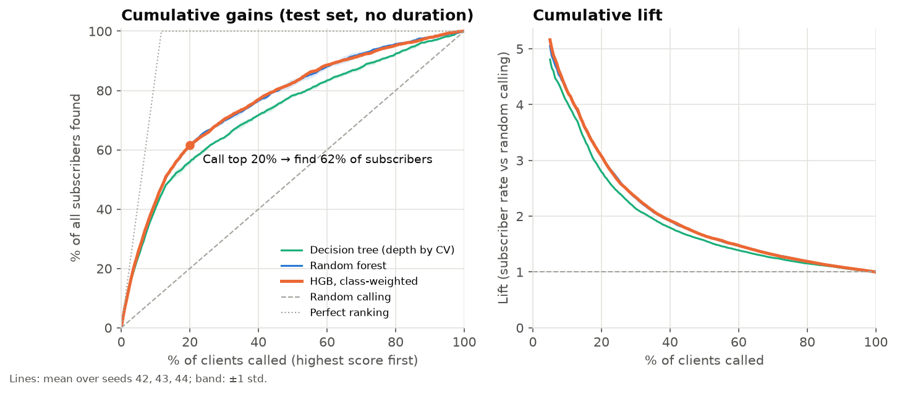
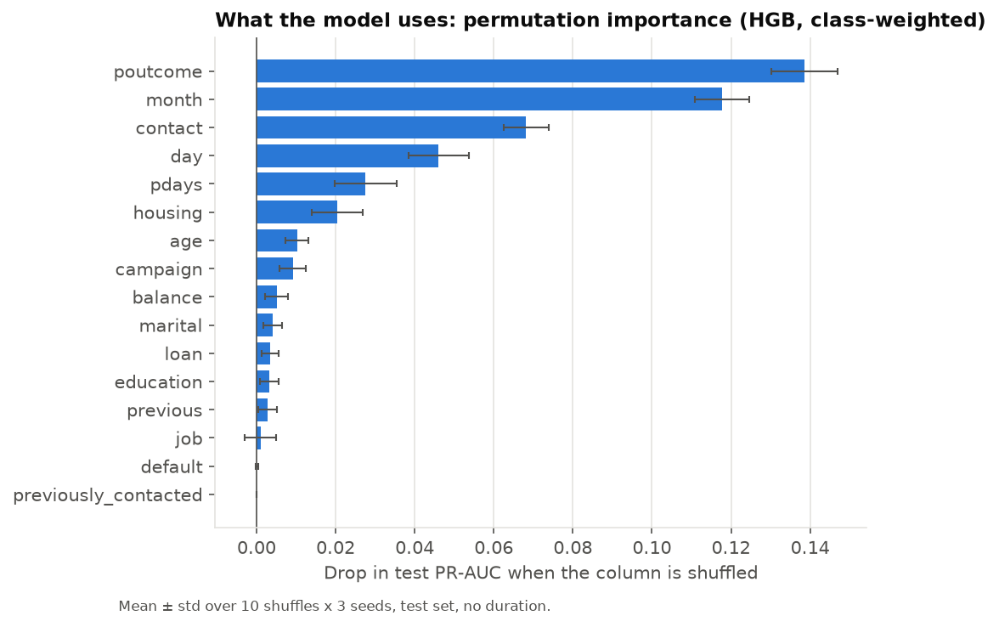

# CallWise: predicting who will say "yes" before the call is made

**EC-417 Term Project P05 (Bank Telemarketing: Trees, Forests and a Famous Leak)** ·
roll nos. 623169, 623195 · NIT Andhra Pradesh

> **Headline.** Without the leaky `duration` feature, the best models reach a **test PR-AUC of about 0.44**,
> 3.8× the no-skill line of 0.117. Class-weighted gradient boosting (**0.441 ± 0.007**) ties the random
> forest (**0.438 ± 0.005**) rather than beating it, and the class weighting itself does not help:
> the unweighted ablation scores 0.446 ± 0.003 and gives much better-calibrated probabilities.
> Calling the top 20% of the ranked list finds **62% of all subscribers** (lift 3.1).

The full write-up with the reasoning is in [report/report.pdf](report/report.pdf); the 10 slides are in
[slides/CallWise_P05_slides.pdf](slides/CallWise_P05_slides.pdf) (PowerPoint source alongside).

---

## 2. Problem

A Portuguese bank phones clients to sell a term deposit. Most calls fail: only **11.7%** of clients subscribe.
The task is to estimate, **before the call**, the probability that a client subscribes, so the call centre can
rank its list and phone the most promising clients first.

* **Task:** binary classification, `y = 1` if the client subscribed.
* **Primary metric: PR-AUC** (average precision). With 11.7% positives, a model that always says "no" is 88.3%
  accurate and useless. PR-AUC measures how well the rare positives are found; its no-skill value is the
  positive rate (0.117), so the trivial baseline is visible in the table.
* **Secondary:** ROC-AUC (reads optimistic on imbalanced data, so it is reported but not used for decisions),
  precision / recall / F1 at a threshold chosen on validation, the lift chart and expected profit.

## 3. Data

| Item | Detail |
|---|---|
| Source | UCI Machine Learning Repository, [Bank Marketing (id 222)](https://archive.ics.uci.edu/dataset/222/bank+marketing), file `bank-full.csv` |
| Size | 45,211 calls (May 2008 – Nov 2010), 16 features + target, no empty cells |
| Licence | CC BY 4.0 (Moro, Cortez & Rita, 2014) |
| Class balance | 39,922 no (88.3%) · 5,289 yes (11.7%) |
| Split | Stratified 70 / 15 / 15. The **test set (6,782 rows) is drawn once with seed 42 and is identical for every model and seed**. Seeds 42, 43, 44 change only the train/validation split and the models' `random_state`. |

**The leak.** `duration` (the length of the call) is the strongest predictor, but it is only known after the
call has ended, and a 0-second call is always a "no". Every model is run on two feature sets:

* **FULL** (16 features + `previously_contacted`): reference only, to measure the leak.
* **DEPLOYABLE** (no `duration`): what could actually be used to decide whom to call. **All headline numbers
  come from this set.**

`"unknown"` values are kept as their own category (they carry signal) and `pdays = -1` ("never contacted") is
kept as-is, plus a `previously_contacted` flag. Full details, citation and checksum: [data/README.md](data/README.md).
Exploratory analysis: [notebooks/01_eda.ipynb](notebooks/01_eda.ipynb). Experiments walkthrough:
[notebooks/02_experiments.ipynb](notebooks/02_experiments.ipynb).



## 4. Method



| Role | Model | Tuning (all scored by PR-AUC) |
|---|---|---|
| Trivial baseline | `DummyClassifier(strategy="prior")` | none |
| Baseline | Decision tree | `max_depth` ∈ {2…15, None} × `min_samples_leaf` ∈ {1, 5, 20, 50, 100, 200, 400}, 5-fold stratified CV on the training part |
| Main model | Random forest, 300 trees | 18 configurations (`max_depth`, `min_samples_leaf`, `max_features`) compared on validation |
| **Improvement** | `HistGradientBoostingClassifier(class_weight="balanced")` | 24 configurations (learning rate, leaves, leaf size, L2) on validation; early stopping picks the number of trees |
| Ablation | Same boosting model, `class_weight=None` | the configuration chosen for the weighted model, so only the weighting changes |

**Why this improvement.** Boosting adds shallow trees one at a time, each fitted to the current errors, which
tends to capture interactions such as month × contact type better than averaging independent trees.
`class_weight="balanced"` gives each "yes" about 7.5× the weight of a "no" in the loss, so the 88% "no" calls do
not dominate training. The ablation isolates the effect of the weighting.

**Leak-free by construction:** the test set is split off before anything is fitted; every encoder sits inside a
scikit-learn `Pipeline` fitted on training rows; hyperparameters, thresholds and the choice of "best model" were
all fixed on validation; the test set was scored once, at the end.

## 5. Results

Test set (6,782 clients, 793 subscribers), **mean ± std over seeds 42, 43, 44**. Threshold t\* = the one that
maximised F1 on validation. Train time = fitting the chosen configuration once (Intel Core Ultra 5 225H, CPU);
hyperparameter search took 15–60 s per model and seed on top of this.

| Model | Features | PR-AUC | ROC-AUC | Recall @ t\* | Train time |
|---|---|---|---|---|---|
| Trivial baseline (prior) | DEPLOYABLE | 0.117 ± 0.000 | 0.500 ± 0.000 | – | – |
| Decision tree (depth by CV) | DEPLOYABLE | 0.399 ± 0.003 | 0.755 ± 0.001 | 0.475 ± 0.012 | 0.3 s |
| Random forest | DEPLOYABLE | 0.438 ± 0.005 | 0.796 ± 0.002 | 0.521 ± 0.011 | 3.8 s |
| **+ HGB, class-weighted** | DEPLOYABLE | **0.441 ± 0.007** | **0.797 ± 0.001** | 0.520 ± 0.013 | 1.7 s |
| HGB, unweighted (ablation) | DEPLOYABLE | 0.446 ± 0.003 | 0.801 ± 0.002 | 0.497 ± 0.020 | 1.2 s |
| Decision tree | FULL (leaky) | 0.551 ± 0.007 | 0.901 ± 0.005 | 0.683 ± 0.054 | 0.4 s |
| Random forest | FULL (leaky) | 0.609 ± 0.006 | 0.927 ± 0.000 | 0.715 ± 0.036 | 1.8 s |
| HGB, class-weighted | FULL (leaky) | 0.625 ± 0.004 | 0.931 ± 0.001 | 0.683 ± 0.024 | 1.9 s |

Raw numbers: [results/metrics.csv](results/metrics.csv) (test) and [results/val_metrics.csv](results/val_metrics.csv)
(validation, with the chosen hyperparameters).

**What the table says**

1. **Every model beats the trivial baseline by a wide margin**, and the ensembles beat the single tree
   (0.44 vs 0.40 PR-AUC, far outside the seed-to-seed spread of about 0.005).
2. **Boosting does not meaningfully beat the forest.** 0.441 vs 0.438 is within one standard deviation; the
   precision–recall and gains curves lie on top of each other.
3. **Class weighting does not help ranking and hurts the probabilities.** The unweighted ablation is slightly
   better on PR-AUC, and the weighted model's Brier score nearly doubles (0.082 → 0.149): a predicted 0.6 means
   about a 22% chance of subscribing. This is the expected effect of re-weighting: it shifts scores up but
   barely changes their order.
4. **The leak is large.** Adding `duration` raises PR-AUC by 0.15–0.18 for every model (about 28% of the leaky
   score) and ROC-AUC from about 0.80 to 0.93.
5. **Validation was slightly optimistic.** Every model scored about 0.02 lower on test than on validation
   (e.g. weighted HGB 0.460 → 0.441), as expected after picking the best of many configurations on validation.
   The ranking of the models did not change.

| | |
|---|---|
|  |  |



**Business view** (weighted HGB, the model with the best validation PR-AUC):

* Calling the top 10% of the ranked list finds 42% of subscribers; the top 20% finds 62% (lift ≈ 3.1).
* At the validation-chosen threshold the model calls 14% of clients; 44% of those calls end in a
  subscription, and 52% of all subscribers are reached ([F7](results/figures/F7_confusion_matrix.png)).
* With a call cost of 5 and a reward of 50 per subscription, the threshold chosen on validation earns
  about 17.6k on the test list, against 5.7k for calling everyone. At reward 25, calling everyone loses
  14.1k while the model still earns 5.7k ([F8](results/figures/F8_profit_threshold.png)).



**What the model uses** (permutation importance on the test set): the outcome of the previous campaign
(`poutcome`) and the `month` dominate, followed by `contact` type, `day` and `pdays`. Demographics (job,
education, marital status) add very little. `previously_contacted` shows zero importance because it carries
the same information as `pdays = -1`.

Other figures: [F4 ROC curves](results/figures/F4_roc_curves.png),
[F9 reliability diagram](results/figures/F9_reliability.png),
[decision-tree depth curve](results/figures/DT_cv_depth_curve.png).

## 6. Error analysis

Details and the example tables are in [results/ERROR_ANALYSIS.md](results/ERROR_ANALYSIS.md)
(top-20 false positives and false negatives, slices by job, age band, contact type, month and `poutcome`).

1. **First-time contacts carry little signal.** 82% of test clients were never contacted before
   (`poutcome = unknown`). On them PR-AUC is 0.31, against 0.75 for clients whose previous campaign succeeded.
   16 of the 20 most confident misses are first-time contacts.
2. **`contact = unknown` / May calls are nearly invisible.** The model calls under 1% of the `contact = unknown`
   clients and finds only 8% of the 79 subscribers among them; in May (the busiest month, 7% positive rate)
   recall is 22%. These rows come mostly from the early campaign, where little was recorded.
3. **Missed subscribers were persuaded on the call.** The median call length of the false negatives is 656 s,
   against 161 s for true negatives (shown for context; the model never sees it). Whatever converted them
   happened during the call, so no pre-call feature records it. This is the leak seen from the other side.
4. **Over-trust in a previous success.** All 20 most confident false positives had `poutcome = success`. The model
   calls every such client and 62% of them subscribe, so it is still a good bet, but it explains the
   confident errors.

## 7. Limitations and ethics

* **Leakage risk.** `duration` must never reach the deployed model. Other columns are also measured "at the last
  contact" (`day`, `month`, `campaign`); here they are treated as known when the call is scheduled, which holds
  for a planned call but should be checked against how the list is actually built.
* **Random, not temporal, split.** Calls from 2008–2010 are shuffled across train and test, so the scores say
  nothing about predicting a future campaign. `month` is the second most important feature, and part of that may
  be campaign-specific timing rather than a stable seasonal effect. A split by time would be the honest test.
* **Old data from one bank.** Results from a Portuguese bank during the 2008–2010 financial crisis may not
  transfer to other banks, countries or interest-rate conditions.
* **Fairness of targeting.** The model calls 68% of clients aged 60+ and 51% of students, against about 9% of
  clients aged 40–59, because those groups subscribe more often. That is accurate, but it means some groups are
  phoned far more often than others; older clients in particular can be vulnerable to pressure selling. Any real
  use should set contact limits per client and review who is being targeted.
* **Uncalibrated scores.** The class-weighted model's probabilities are inflated (F9). They are fine for ranking
  but must not be read as real chances or plugged directly into a cost rule.
* **Course history rule.** The brief asks for at least 4 meaningful commits over 4 weeks. This was a short,
  ungraded practice run, so the commit history spans under two weeks.

## 8. Reproduce

Tested with **Python 3.12.10** on Windows 11, Intel Core Ultra 5 225H (14 threads), 16 GB RAM, CPU only.

```bash
git clone https://github.com/sahitya1903/ec417-miniproject-P05-623169-623195.git
cd ec417-miniproject-P05-623169-623195
pip install -r requirements.txt

python scripts/get_data.py && python -m src.train --final && python -m src.evaluate
```

* `scripts/get_data.py` downloads `bank-full.csv` from UCI into `data/raw/` (git-ignored) and checks its shape.
* `src.train --final` tunes and fits every model on both feature sets and three seeds, writes
  `results/val_metrics.csv`, and scores the locked test set into `results/metrics.csv`.
  Without `--final` only validation scores are produced. Fitted models go to `checkpoints/` (git-ignored).
* `src.evaluate` prints the summary tables and writes every figure in `results/figures/` and the error-analysis CSVs.
* **Runtime:** about 17.5 minutes on the machine above (training 16.5 min, almost all of it hyperparameter search; evaluation 1 min). Re-running from a fresh clone reproduced every test metric in `results/metrics.csv` exactly (train times aside).
* `notebooks/02_experiments.ipynb` runs top to bottom in under a minute: it re-fits the configuration `src.train`
  chose for every model (seed 42), checks that the validation scores match `results/val_metrics.csv` exactly, and
  reads (never re-scores) the test results.
* `python scripts/build_report.py` rebuilds `report/report.pdf` from `report/report.md` (needs Chrome or Edge).

```
├── data/README.md          source, licence, citation, split
├── scripts/get_data.py     download the dataset
├── scripts/build_report.py report.md -> report.pdf
├── src/data.py             load, feature sets, leak-free split
├── src/models.py           dummy, tree, forest, boosting + search spaces
├── src/train.py            tune, fit, score -> results/*.csv
├── src/metrics.py          PR-AUC, ROC-AUC, Brier, threshold metrics
├── src/evaluate.py         summaries and figures F1-F9
├── src/errors.py           error analysis and slices
├── notebooks/01_eda.ipynb  exploratory data analysis
├── notebooks/02_experiments.ipynb  experiments walkthrough (runs in < 1 min)
├── results/                metrics, figures, ERROR_ANALYSIS.md
├── report/                 report.md and report.pdf
└── slides/                 10 slides (.pptx and .pdf)
```

## 9. AI-use statement

We completed most of this project ourselves, including the implementation, experiments, analysis, notebooks,
README, report and slides. We used **Claude (Anthropic), through Claude Code, only for review purposes**:
to review our work and suggest improvements. Every number in the README and report was produced by the code
in this repository and copied from `results/*.csv`; none was typed in by hand from memory. We reviewed the
code, the split and leak-prevention logic, and the figures, and checked the headline numbers against
`results/metrics.csv`. We are responsible for all content and can explain every step.

## 10. References

1. S. Moro, P. Cortez and P. Rita, "A data-driven approach to predict the success of bank telemarketing,"
   *Decision Support Systems*, vol. 62, pp. 22–31, 2014.
2. S. Moro, P. Rita and P. Cortez, "Bank Marketing," UCI Machine Learning Repository, 2014. doi:10.24432/C5K306.
3. L. Breiman, "Random Forests," *Machine Learning*, vol. 45, pp. 5–32, 2001.
4. J. H. Friedman, "Greedy function approximation: a gradient boosting machine," *Annals of Statistics*,
   vol. 29, no. 5, pp. 1189–1232, 2001.
5. F. Pedregosa et al., "Scikit-learn: Machine Learning in Python," *JMLR*, vol. 12, pp. 2825–2830, 2011.
6. T. Saito and M. Rehmsmeier, "The precision-recall plot is more informative than the ROC plot when evaluating
   binary classifiers on imbalanced datasets," *PLOS ONE*, 10(3), 2015.

Licence: code under the [MIT licence](LICENSE); the dataset is CC BY 4.0 and is not redistributed here.
