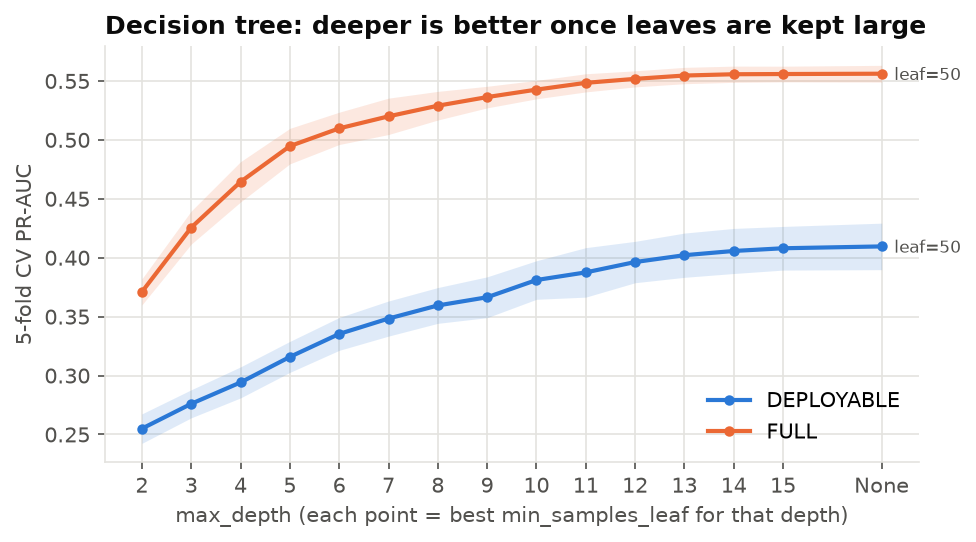
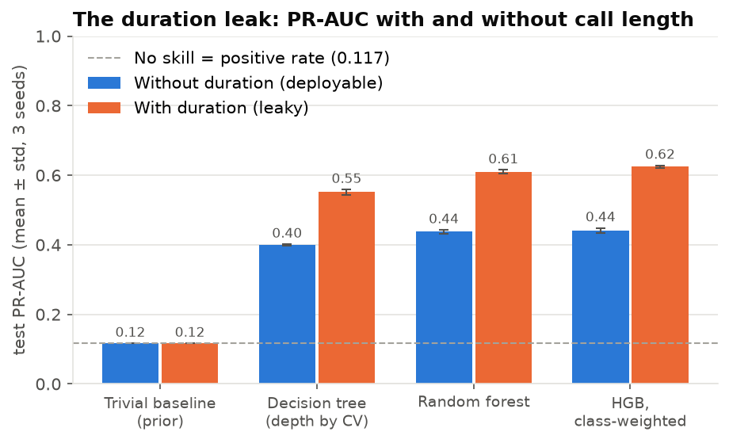
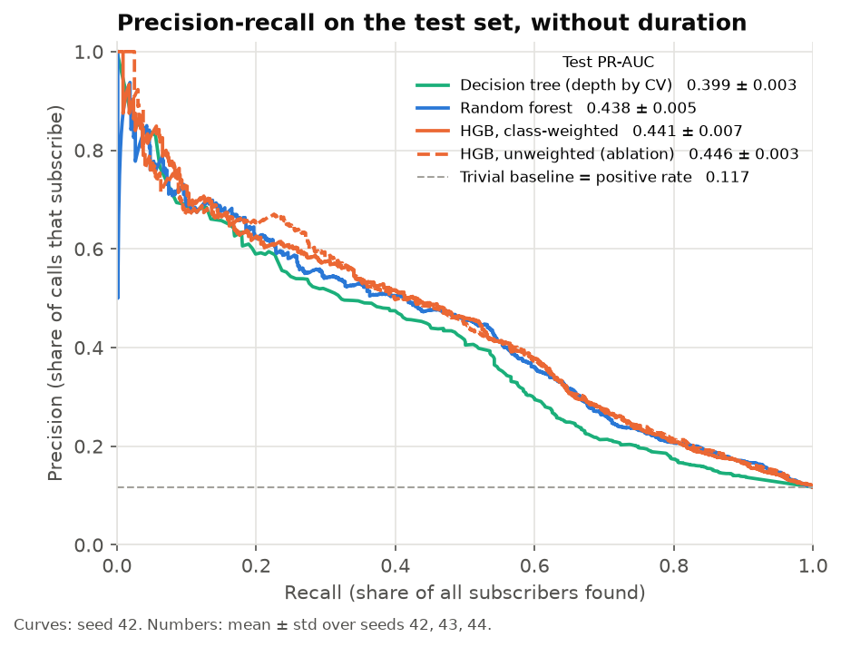
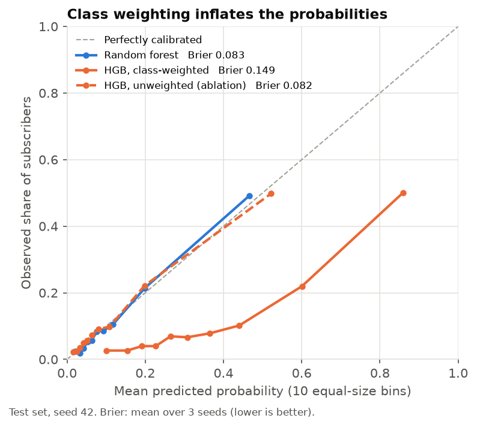
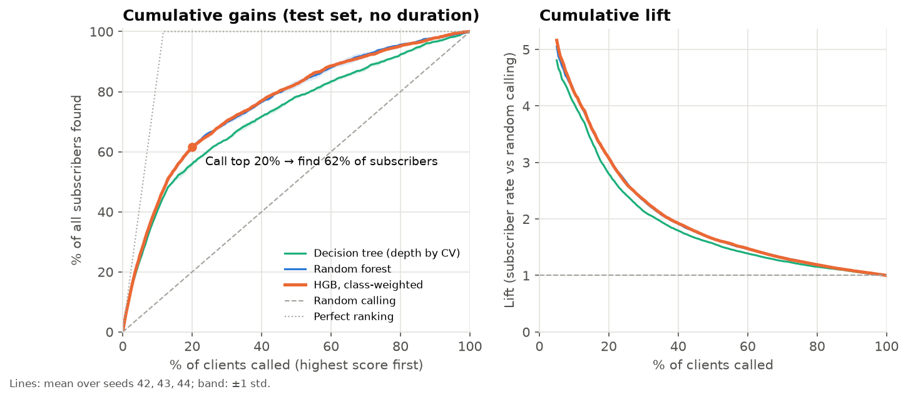
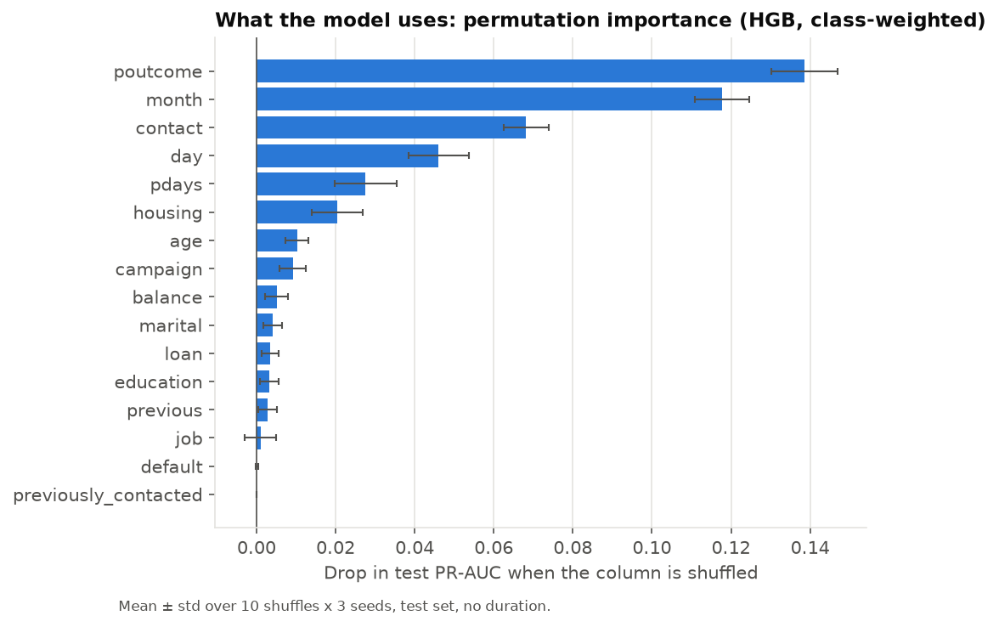
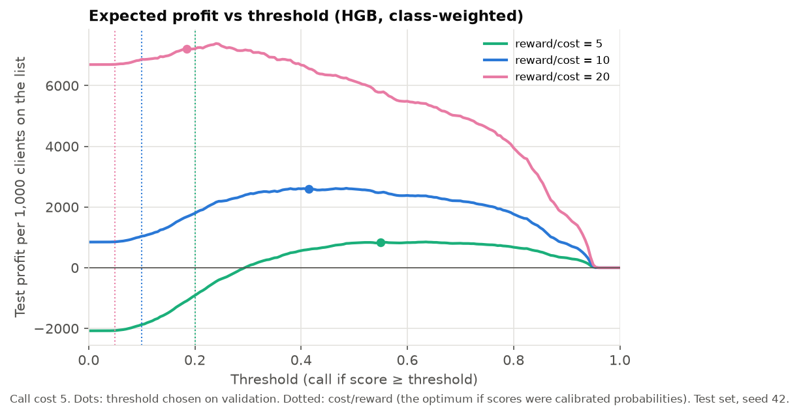

# CallWise: Predicting Who Will Say "Yes" Before the Call Is Made

**EC-417 Introduction to Machine Intelligence · Term Project P05: Bank Telemarketing: Trees, Forests and a Famous Leak** 
Roll nos. 623169, 623195 · Department of ECE, NIT Andhra Pradesh · November 2026 
Code: github.com/sahitya1903/ec417-miniproject-P05-623169-623195

**Summary.** We rank bank clients by their chance of subscribing to a term deposit, using only information
available before the call. On a locked test set, and without the leaky `duration` feature, a decision tree
reaches PR-AUC 0.399 ± 0.003, a random forest 0.438 ± 0.005 and class-weighted gradient boosting
0.441 ± 0.007 (mean ± std over three seeds; no-skill = 0.117). Boosting ties the forest rather than beating it,
and an ablation shows that class weighting does not improve ranking (unweighted: 0.446 ± 0.003) while it nearly
doubles the Brier score. Including `duration` would have added 0.15–0.18 PR-AUC to every model. Calling the
top-ranked 20% of clients reaches 62% of subscribers.

## 1. Problem and metric

A Portuguese bank sold term deposits through phone campaigns between May 2008 and November 2010. Most calls fail:
only 11.7% of clients subscribed. Our task is to estimate, before a client is called, the probability that they
subscribe, so that the call centre can sort its list and phone the most promising clients first. This is a
binary classification problem (`y = 1` for "yes"), but the model is used as a **ranker**.

**Why PR-AUC.** Accuracy is the wrong yardstick: a model that always predicts "no" is 88.3% accurate and finds
nobody. ROC-AUC is better but reads optimistically under heavy imbalance, because its false-positive rate is
divided by the large number of negatives, so thousands of wasted calls barely move it [6]. The area under the
precision–recall curve (average precision) asks the question the bank cares about: of the clients we call, how
many subscribe (precision), and what share of all subscribers do we reach (recall)? Its no-skill value is the
positive rate, 0.117, which makes the trivial baseline easy to read. PR-AUC is the primary metric for every
choice in this project; ROC-AUC, threshold metrics, the gains chart and an expected-profit model are reported
alongside it.

## 2. Data

We use `bank-full.csv` from the UCI Bank Marketing dataset [1, 2] (CC BY 4.0): 45,211 calls, 16 features and the
target, no empty cells. Missing information is coded as the string `"unknown"` (in `job`, `education`, `contact`
and `poutcome`). We keep it as its own category instead of imputing it, because it is informative: for example,
clients with `contact = unknown` were almost all called in May–June and subscribed at only 4%. `pdays = -1` means
"never contacted before" (82% of rows); we keep it and add a flag `previously_contacted`. No scaling is needed
because every model is tree-based.

**The leak.** `duration` is the length of the call in seconds. It is by far the strongest predictor (long calls
are conversations that went well, and a 0-second call is always a "no"), but it is only known after the call has
ended, so it cannot help decide whom to call. We therefore run every model on two feature sets:
**FULL** (all features, reference only) and **DEPLOYABLE** (no `duration`). All headline results use DEPLOYABLE.

**Split.** We first draw a stratified 15% **test set (6,782 rows) with a fixed seed of 42**; it is identical for
every model and seed and was not touched until the final evaluation. The remaining 85% is split, stratified,
into train (70% of all rows) and validation (15%). Seeds 42, 43 and 44 change this inner split and the models'
random state, so the standard deviations we report cover both data sampling and model randomness.

## 3. Method

**Leak control.** Beyond removing `duration`, three rules keep the test score honest. (i) The split happens before
anything is fitted. (ii) The one-hot encoder lives inside a scikit-learn `Pipeline`, so it is fitted on training
rows only; the boosting model reads categories natively. (iii) Every decision (hyperparameters, decision
threshold, which model to call "best") is taken on training or validation data. The test set was scored exactly
once, after all of these were frozen.

| Role | Model | How it is tuned (always by PR-AUC) |
|---|---|---|
| Trivial baseline | Predict the training positive rate for everyone | – |
| Baseline | Decision tree on one-hot features | depth {2,…,15, unlimited} × min. leaf size {1, 5, 20, 50, 100, 200, 400}; 5-fold stratified CV on the training part |
| Main model | Random forest, 300 trees | 18 configurations of depth, leaf size and features per split, compared on validation |
| Improvement | Histogram gradient boosting, `class_weight="balanced"` | 24 configurations of learning rate, leaves per tree, leaf size and L2 penalty on validation; early stopping picks the number of trees |
| Ablation | Same boosting configuration, no class weights | none: only the weighting changes |

**Why this improvement.** A random forest averages many deep, decorrelated trees, which mainly reduces variance
[3]. Gradient boosting adds small trees one after another, each fitted to the gradient of the loss of the current
ensemble, which mainly reduces bias and tends to pick up interactions such as `month` × `contact` [4]. With
`class_weight="balanced"` each sample is weighted by n / (2 · nclass): a "yes" gets weight 4.27 and a
"no" 0.57, so each subscriber counts about 7.5 times as much in the loss. The hope was that this stops the 88% "no"
calls from dominating training. We expected, and checked with the ablation, that re-weighting might change
ranking metrics very little, because it mostly shifts predicted probabilities upward.

**Threshold and cost model.** For the threshold metrics we pick, per model and seed, the score threshold that
maximises F1 on validation and freeze it. For the business view we model each call as costing c = 5 and each
subscription as earning r = 50 (sensitivity: r/c = 5 and 20). Profit is r·TP − c·(TP + FP). The profit-maximising
threshold is again chosen on validation and reported on test. If the scores were calibrated probabilities, the
optimum would sit near p = c/r.

## 4. Results

**Tuning outcomes.** The tree depth curve (Figure 1, left) rises steadily: with leaves held at 50–100 samples,
deeper is always better, and CV picked unlimited depth with leaf size 50 or 100 on DEPLOYABLE. The leaf size, not
the depth, controls overfitting here. We first searched leaf sizes up to 50 only, and CV picked the edge of the
grid every time, so we widened it. The forest settled on depth 20 and leaf size 5 for all three seeds.
For boosting the validation surface was flat: for two of the three seeds, 12–14 of the 24 configurations scored
within 0.005 of the best, and the chosen settings differed by seed. Early stopping kept 79 to 335 trees.

<figure class="pair">

<figcaption>Figure 1 (left). Decision-tree depth chosen by 5-fold CV on the training part (seed 42); band = ±1 std over folds. (Right) The leak: test PR-AUC with and without <code>duration</code>.</figcaption></figure>

**Main comparison.** Table 1 gives the test results. The test set was scored once, after every choice above.

Table 1. Test set (6,782 clients, 793 subscribers), mean ± std over seeds 42, 43, 44. Recall at the threshold t* chosen on validation. Train time: one fit of the chosen configuration on a laptop CPU (Intel Core Ultra 5 225H).

| Model | Features | PR-AUC | ROC-AUC | Recall @ t* | Brier | Train time |
|---|---|---|---|---|---|---|
| Trivial baseline (prior) | DEPLOYABLE | 0.117 ± 0.000 | 0.500 ± 0.000 | – | 0.103 | – |
| Decision tree (depth by CV) | DEPLOYABLE | 0.399 ± 0.003 | 0.755 ± 0.001 | 0.475 ± 0.012 | 0.087 | 0.3 s |
| Random forest | DEPLOYABLE | 0.438 ± 0.005 | 0.796 ± 0.002 | 0.521 ± 0.011 | 0.083 | 3.8 s |
| **+ HGB, class-weighted** | DEPLOYABLE | **0.441 ± 0.007** | **0.797 ± 0.001** | 0.520 ± 0.013 | 0.149 | 1.7 s |
| HGB, unweighted (ablation) | DEPLOYABLE | 0.446 ± 0.003 | 0.801 ± 0.002 | 0.497 ± 0.020 | 0.082 | 1.2 s |
| Decision tree | FULL (leaky) | 0.551 ± 0.007 | 0.901 ± 0.005 | 0.683 ± 0.054 | 0.069 | 0.4 s |
| Random forest | FULL (leaky) | 0.609 ± 0.006 | 0.927 ± 0.000 | 0.715 ± 0.036 | 0.064 | 1.8 s |
| HGB, class-weighted | FULL (leaky) | 0.625 ± 0.004 | 0.931 ± 0.001 | 0.684 ± 0.024 | 0.095 | 1.9 s |

Four findings follow.

1. **Ensembles beat the single tree clearly.** The forest improves PR-AUC from 0.399 to 0.438 and ROC-AUC from
   0.755 to 0.796, a gap many times larger than the seed-to-seed spread.
2. **Boosting ties the forest.** 0.441 ± 0.007 against 0.438 ± 0.005 is within one standard deviation, and the
   precision–recall curves (Figure 2, left) and gains curves lie on top of each other. On this data, with 15
   mostly categorical features, the forest already captures what the features can tell us. The required
   improvement does not help, and we report it as such.
3. **Class weighting does not help ranking and damages the probabilities.** The unweighted ablation scores slightly
   higher on PR-AUC (0.446) and ROC-AUC (0.801). The weighted model's Brier score is almost twice as large
   (0.149 against 0.082). Figure 2 (right) shows why: weighting pushes every score up, so a predicted 0.6 corresponds
   to an observed subscription rate of about 22%. Because the shift preserves the order of clients, ranking
   metrics barely change. This matches what we expected in Section 3.
4. **The leak is large and uniform.** Adding `duration` raises PR-AUC by 0.153 (tree), 0.172 (forest) and 0.184
   (boosting), roughly 28% of the leaky score, and lifts ROC-AUC from about 0.80 to above 0.90 (Figure 1, right).
   A report built on the FULL set would look excellent and be useless for planning calls.

Validation was slightly optimistic: every model scored about 0.02 lower on test than on validation (weighted
boosting 0.460 → 0.441, forest 0.458 → 0.438, tree 0.405 → 0.399). This is the expected cost of picking the best
of many configurations on the same validation set. The ranking of the models did not change.

<figure class="pair">

<figcaption>Figure 2 (left). Test precision–recall curves, DEPLOYABLE set (seed 42). (Right) Reliability diagram: class weighting inflates the predicted probabilities.</figcaption></figure>

**Business view.** We use the weighted boosting model, which had the best validation PR-AUC. Calling the top 10%
of the ranked list reaches 42% of all subscribers, and the top 20% reaches 62%, a lift of about 3.1 over random
calling (Figure 3). At the F1-optimal threshold the model calls 14% of clients; 44% of those calls succeed and
52% of all subscribers are reached (416 found, 377 missed, 538 wasted calls for seed 42). With c = 5 and r = 50,
the threshold chosen on validation earns about 17.6k on the test list, against 5.7k for calling everyone. At
r/c = 5, calling everyone loses 14.1k while the model still earns 5.7k. For the weighted model the
profit-maximising threshold is 0.42–0.47, far above c/r = 0.10. For the unweighted model it is 0.105–0.135, close
to c/r. Calibrated probabilities can be used directly as a decision rule; weighted ones cannot.

<figure class="wide"><figcaption>Figure 3. Cumulative gains and lift on the test set (mean over three seeds, band ±1 std).</figcaption></figure>

**What the model uses.** Permutation importance on the test set (Figure 4) measures the drop in PR-AUC when one
column is shuffled; unlike impurity importance it is not biased toward many-valued features. The outcome of the
previous campaign (`poutcome`, drop 0.14) and the `month` (0.12) dominate, then `contact` type, `day`, `pdays` and
`housing`. Job, education and marital status matter very little. `previously_contacted` scores zero because it
duplicates `pdays = -1`: shuffling one column leaves the same information in the other. Permutation importance
hides shared signal in this way, so a low score does not mean a feature carries no information.

<figure class="pair">

<figcaption>Figure 4 (left). Permutation importance, weighted boosting, test set (10 shuffles × 3 seeds). (Right) Expected profit per 1,000 clients against the threshold for three reward/cost ratios.</figcaption></figure>

## 5. Error analysis

We profiled the four cells of the confusion matrix, listed the 20 most confident false positives and false
negatives, and computed test PR-AUC and recall on slices (Table 2; full tables in `results/`).

Table 2. Selected test slices, weighted boosting, mean over the three seeds.

| Slice | Clients | Subscriber rate | PR-AUC | Recall | Share called |
|---|---|---|---|---|---|
| All clients | 6,782 | 11.7% | 0.44 | 0.52 | 14% |
| `poutcome = unknown` (first contact) | 5,536 | 9.0% | 0.31 | 0.37 | 8% |
| `poutcome = success` | 236 | 61.9% | 0.75 | 1.00 | 100% |
| `contact = unknown` | 1,967 | 4.0% | 0.12 | 0.08 | 1% |
| `month = may` | 2,054 | 7.0% | 0.28 | 0.22 | 4% |
| age 60+ | 258 | 32.2% | 0.55 | 0.88 | 68% |
| age 40–49 | 1,722 | 9.6% | 0.39 | 0.44 | 9% |

**Failure mode 1: first-time contacts carry little signal.** 82% of test clients were never contacted before, so
the strongest feature (`poutcome`) says "unknown" for them. On this slice PR-AUC falls to 0.31. Sixteen of the 20
most confident false negatives are first-time contacts, and none of the 377 missed subscribers had a previous
success.

**Failure mode 2: `contact = unknown` and May calls are nearly invisible.** The model calls under 1% of the
`contact = unknown` clients and finds only 8% of their 79 subscribers. In May, the busiest month, recall is 22%;
13 of the top-20 false negatives are May calls with unknown contact type. These rows come mostly from the early
2008 campaign, where little was recorded, so the model has learnt that this group is a poor bet. On average that
is true, but it leaves the subscribers inside the group unreachable.

**Failure mode 3: missed subscribers were persuaded during the call.** The false negatives had a median call length
of 656 s, against 161 s for true negatives (shown for context; the model never sees it). In the pre-call features
they look like the clients who did not subscribe: a similar share with a housing loan (59% against 60%) and
rarely contacted before (17% against 13%). Whatever made
them subscribe happened on the call. This is the leak seen from the other side, and no pre-call model can recover
it.

**Over-trust in a previous success.** All 20 most confident false positives had `poutcome = success`. The model
calls every such client, and 62% of them subscribe, so it is still the right decision; it simply explains where
the confident mistakes come from.

## 6. Limitations and ethics

* **Random, not temporal, split.** Calls from 2008–2010 are shuffled across train and test, so our scores do not
  measure how well a model trained on past campaigns predicts a future one. `month` ranks second in importance,
  and part of its effect may be specific to how these campaigns were scheduled rather than a stable seasonal
  pattern. A split by time is the honest test and would likely give lower
  scores.
* **Other borderline columns.** `day`, `month` and `campaign` are recorded at the last contact. We treat them as
  known when the call is scheduled, which holds for a planned call but should be checked against how a real call
  list is built.
* **Transfer.** The data come from one Portuguese bank during the 2008–2010 financial crisis. The model should not be expected to transfer to other banks, countries or rate conditions without
  retraining.
* **Fairness and misuse.** Because older clients and students subscribe more often, the model calls 68% of clients
  aged 60+ and 51% of students but only about 9% of those aged 40–59. That is accurate, but it concentrates
  sales pressure on groups that may be more vulnerable to it, older clients in particular. A real deployment
  should cap contacts per client, check whether the product suits the client, and audit who is targeted.
* **Calibration.** The weighted model's scores are not probabilities and must not be read as such.

## 7. What we would try next

1. **Temporal split** (train on earlier months, test on later ones) to measure real forward performance.
2. **Calibration** of the chosen model with `CalibratedClassifierCV` (isotonic) on the validation set, then a
   profit threshold set directly at c/r.
3. **A cost-sensitive objective or per-segment thresholds**, for example a separate threshold for first-time
   contacts, where the model is weakest.
4. **Better features for first-time contacts**, such as interactions between month and contact type, or external
   data (interest rates at the time of the call, as in the 20-feature version of this dataset).
5. **A fairness check across age groups** with contact caps built into the selection rule.

## 8. Reproducibility and AI use

The repository regenerates every number in this report with one command after installing the pinned
requirements: `python scripts/get_data.py && python -m src.train --final && python -m src.evaluate`. It runs on a
laptop CPU in about 17.5 minutes (Python 3.12.10, scikit-learn 1.9.0). The dataset and fitted models are not committed; the download
script fetches the data from UCI and checks its shape.

**AI-use statement.** We completed most of this project ourselves, including the implementation, experiments,
analysis, notebooks, README, report and slides. We used Claude (Anthropic), through Claude Code, only for review
purposes: to review our work and suggest improvements. Every number in the report was produced by the code in the
repository and taken from `results/*.csv`. We reviewed the code, the split and leak-prevention logic, and the
figures, and checked the headline numbers against `results/metrics.csv`. We are responsible for the content and
can explain every step.

## References

1. S. Moro, P. Cortez and P. Rita, "A data-driven approach to predict the success of bank telemarketing," *Decision Support Systems*, vol. 62, pp. 22–31, 2014.
2. S. Moro, P. Rita and P. Cortez, "Bank Marketing," UCI Machine Learning Repository, 2014. doi:10.24432/C5K306.
3. L. Breiman, "Random Forests," *Machine Learning*, vol. 45, pp. 5–32, 2001.
4. J. H. Friedman, "Greedy function approximation: a gradient boosting machine," *Annals of Statistics*, vol. 29, no. 5, pp. 1189–1232, 2001.
5. F. Pedregosa et al., "Scikit-learn: Machine Learning in Python," *JMLR*, vol. 12, pp. 2825–2830, 2011.
6. T. Saito and M. Rehmsmeier, "The precision-recall plot is more informative than the ROC plot when evaluating binary classifiers on imbalanced datasets," *PLOS ONE*, 10(3), 2015.

